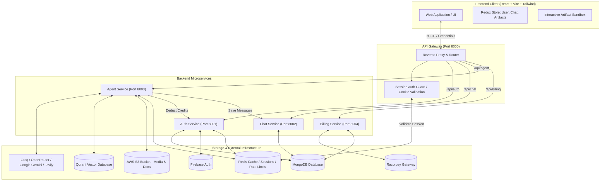
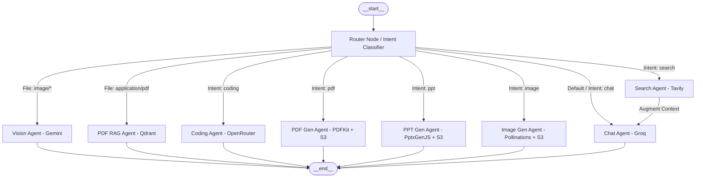
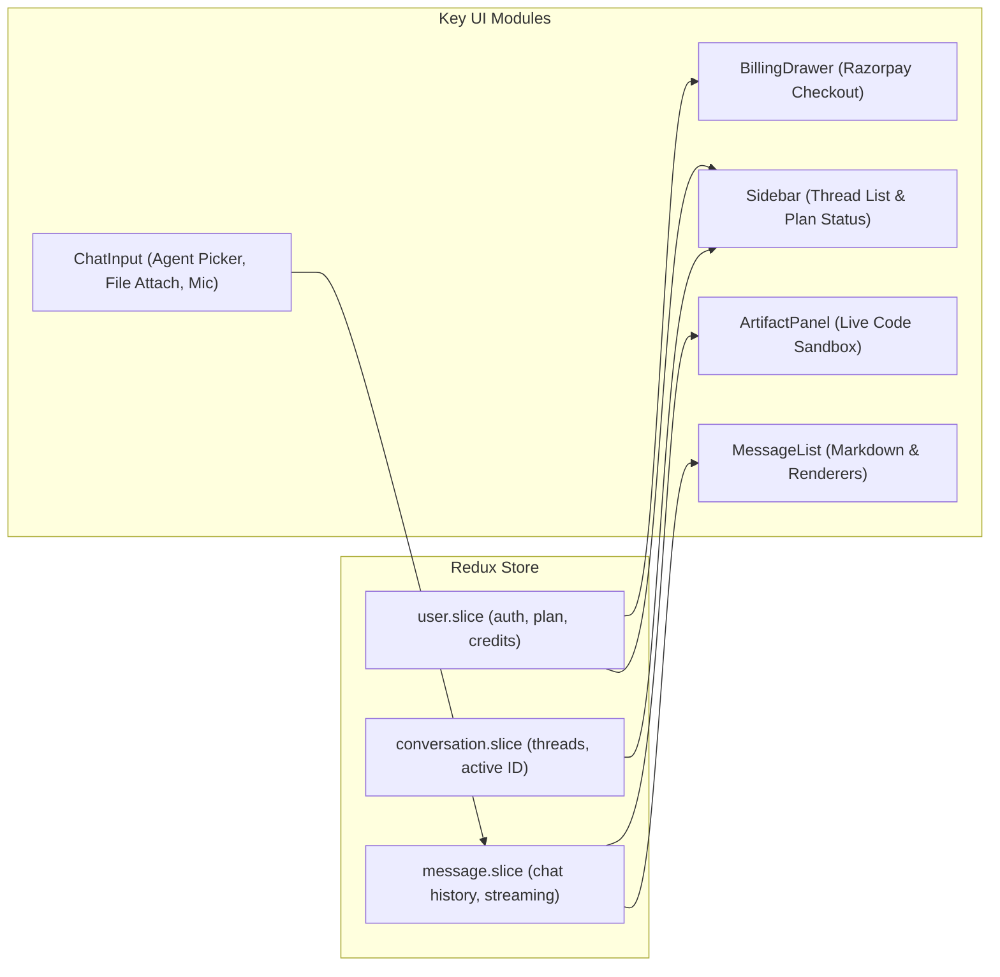

# 🌌 NOVA-AI — Comprehensive Architecture & Project Structure Guide

> **Version:** 1.0.0  
> **Architecture Pattern:** Event-Driven Microservices + Centralized API Gateway + Multi-Agent AI Supervisor (LangGraph)  
> **Primary Technology Stack:** Node.js (Express), React (Vite + TailwindCSS + Redux Toolkit), MongoDB, Redis, Qdrant Vector Store, AWS S3, Firebase Auth, LangChain / LangGraph, Razorpay.

---

## 📑 Table of Contents
1. [Executive Overview](#1-executive-overview)
2. [High-Level System Architecture](#2-high-level-system-architecture)
3. [Complete Directory & File Hierarchy](#3-complete-directory--file-hierarchy)
4. [Backend Microservices Breakdown](#4-backend-microservices-breakdown)
   - [API Gateway (Port 8000)](#41-api-gateway-port-8000)
   - [Auth Service (Port 8001)](#42-auth-service-port-8001)
   - [Chat Service (Port 8002)](#43-chat-service-port-8002)
   - [Agent Service (Port 8003) — AI Engine](#44-agent-service-port-8003--ai-engine)
   - [Billing Service (Port 8004)](#45-billing-service-port-8004)
   - [Shared Redis Layer](#46-shared-redis-layer)
5. [LangGraph Multi-Agent Supervisor System](#5-langgraph-multi-agent-supervisor-system)
6. [Frontend Client Architecture (Port 5173)](#6-frontend-client-architecture-port-5173)
7. [Database Schemas & Storage Design](#7-database-schemas--storage-design)
8. [Security, Rate Limiting & Credit Economy](#8-security-rate-limiting--credit-economy)
9. [Development, Scripts & Environment Setup](#9-development-scripts--environment-setup)

---

## 1. Executive Overview

**NOVA-AI** is a fullstack AI productivity workspace. It provides a multi-model, multi-agent AI assistant capable of:
- Autonomous routing across specialized AI tasks
- Conversational chat with 24-hour Redis memory sliding window
- Web-grounded search with live citation capabilities (Tavily)
- Code generation, code review, debugging, and live multi-file artifact rendering
- Instant professional Presentation (`.pptx`) generation uploaded to S3
- Instant document generation (`.pdf`)
- Retrieval-Augmented Generation (RAG) over uploaded PDF documents using Qdrant vector database
- Photorealistic Image Generation using AI prompt synthesis & CDN delivery
- Multi-modal vision analysis on images using Google Gemini
- User credit management, subscription plans, and payment processing with Razorpay

---

## 2. High-Level System Architecture



---

## 3. Complete Directory & File Hierarchy

```
NOVA-AI/
├── package.json                   # Root orchestrator (concurrent dev runners)
├── start-all.bat                  # One-click Windows startup script (WSL Redis + services)
├── start-all.ps1                  # PowerShell startup automation
├── scripts/
│   └── renew-credits.js           # Cron task to renew monthly/daily plan credits
│
├── backend/
│   ├── package.json               # Backend base configuration
│   ├── docker-compose.yml         # Containerized infrastructure config
│   │
│   ├── shared/                    # Shared modules between microservices
│   │   └── redis/
│   │       └── redis.js           # Reusable ioredis client singleton
│   │
│   ├── gateway/                   # Central API Gateway (Port 8000)
│   │   ├── index.js               # Gateway entry, CORS, Helmet, Cookie Parser & Proxy setup
│   │   ├── Dockerfile
│   │   ├── controllers/
│   │   │   └── user.controller.js # /api/me handler
│   │   ├── middlewares/
│   │   │   └── auth.middleware.js # Session validator against Redis & user extractor
│   │   └── utils/
│   │       └── proxyWithHeaders.js# Express HTTP proxy injector (attaches x-user-id)
│   │
│   └── services/                  # Microservice Cluster
│       ├── auth/                  # Authentication & User Management (Port 8001)
│       │   ├── index.js           # Service bootstrap & MongoDB connection
│       │   ├── Dockerfile
│       │   ├── serviceAccount.json# Firebase Admin SDK Credentials
│       │   ├── renew-credits.js   # Credit restoration runner
│       │   ├── config/
│       │   │   ├── db.js          # Mongoose DB connector
│       │   │   └── firebase.js    # Firebase Admin initialization
│       │   ├── controllers/
│       │   │   └── auth.controllers.js # Login, Logout, Session check, Deduct Credits
│       │   ├── models/
│       │   │   └── user.model.js  # User schema (Firebase UID, Plan, Credits)
│       │   └── routes/
│       │       └── auth.routes.js # Auth endpoints definition
│       │
│       ├── chat/                  # Conversation & Message History (Port 8002)
│       │   ├── index.js           # Service entrypoint
│       │   ├── Dockerfile
│       │   ├── config/
│       │   │   └── db.js          # MongoDB database connector
│       │   ├── controllers/
│       │   │   └── chat.controller.js # CRUD for conversations & message persistence
│       │   ├── models/
│       │   │   ├── conversation.model.js # Conversation entity schema
│       │   │   └── message.model.js      # Message history entity schema
│       │   └── routes/
│       │       └── chat.routes.js        # Chat endpoints definition
│       │
│       ├── agent/                 # LangGraph Multi-Agent Supervisor Engine (Port 8003)
│       │   ├── index.js           # Express app & route mounting
│       │   ├── Dockerfile
│       │   ├── config/
│       │   │   ├── agentRateLimit.js # Redis-based rolling rate limiter per agent
│       │   │   ├── db.js             # MongoDB connector
│       │   │   └── multer.js         # Multipart file upload storage config
│       │   ├── controllers/
│       │   │   └── agent.controller.js # Agent chat controller (invokes LangGraph)
│       │   ├── routes/
│       │   │   └── agent.route.js    # /chat route definition with Multer middleware
│       │   ├── graph/                # LangGraph State Machine
│       │   │   ├── state.js          # AgentState annotation definitions
│       │   │   ├── router.node.js    # LLM Router & Mime-type classifier
│       │   │   └── supervisor.graph.js # StateGraph compilation & edge routing
│       │   ├── agents/               # 8 Specialized Agent Implementations
│       │   │   ├── chat.agent.js     # Conversational assistant with context memory
│       │   │   ├── coding.agent.js   # Code generator / reviewer & artifact creator
│       │   │   ├── search.agent.js   # Tavily web search integration
│       │   │   ├── pdf.agent.js      # PDF generator via PDFKit -> S3
│       │   │   ├── pdfRag.agent.js   # PDF RAG via Qdrant & document parsing
│       │   │   ├── ppt.agent.js      # PPTX generator via PptxGenJS -> S3
│       │   │   ├── imageGen.agent.js # Image prompt engineer + Pollinations -> S3
│       │   │   └── vision.agent.js   # Gemini vision analyst for image inputs
│       │   └── utils/
│       │       ├── deductCredits.js  # Inter-service call to deduct user credits
│       │       ├── embedding.js      # FastEmbed / Google Embeddings config
│       │       ├── getConv.js        # Fetch conversation history from Chat Service
│       │       ├── getDownloadUrl.js # S3 pre-signed download URL generator
│       │       ├── memory.js         # Redis conversation buffer memory (20 msgs)
│       │       ├── model.js          # Model factory (Groq, OpenRouter, Gemini)
│       │       ├── s3.js             # AWS S3 client configuration
│       │       ├── tavily.js         # Tavily Search API client
│       │       ├── uploadToS3.js     # Stream buffer uploader to S3
│       │       └── vectorStore.js    # Qdrant vector store connection helper
│       │
│       └── billing/               # Subscription & Payment Management (Port 8004)
│           ├── index.js           # Service bootstrap
│           ├── Dockerfile
│           ├── config/
│           │   └── db.js          # MongoDB database connector
│           ├── controllers/
│           │   └── billing.controller.js # Create order & verify signature (Razorpay)
│           ├── models/
│           │   └── payment.model.js # Payment transactions schema
│           └── routes/
│               └── billing.routes.js# Billing endpoints definition
│
└── frontend/                      # React Single Page Application (Port 5173)
    ├── index.html                 # HTML shell
    ├── vite.config.js             # Vite bundler configuration
    ├── firebase.js                # Firebase Web Client configuration (Google Auth)
    ├── package.json               # Frontend dependencies & scripts
    └── src/
        ├── main.jsx               # React DOM root with Redux Provider
        ├── App.jsx                # Router & Global Auth bootstrap
        ├── index.css              # Custom styling & Tailwind directives
        ├── assets/                # Static assets, SVG icons, hero images
        ├── features/              # API Client callers (Axios wrappers)
        │   ├── agent.api.js       # Agent API hooks
        │   ├── billing.api.js     # Billing API hooks
        │   ├── conversation.api.js# Conversation API hooks
        │   └── message.api.js     # Message API hooks
        ├── hooks/
        │   └── useCurrentUser.jsx # Active user listener & session hydrator
        ├── redux/                 # Redux Toolkit Global State
        │   ├── store.js           # Configured Redux store
        │   ├── user.slice.js      # User auth, plan & credit balance state
        │   ├── conversation.slice.js # Active & history conversations state
        │   └── message.slice.js   # Chat messages & artifact states
        ├── utils/
        │   ├── axios.js           # Pre-configured Axios instance with cookies enabled
        │   └── detectLanguage.js  # Code syntax highlighter language detector
        ├── pages/
        │   └── Home.jsx           # Main unified workplace workspace view
        └── components/            # Reusable UI Components
            ├── Navbar.jsx         # Header navigation
            ├── Sidebar.jsx        # History list, upgrade CTA, user profile & logout
            ├── ChatArea.jsx       # Chat window wrapper
            ├── ChatInput.jsx      # Agent switcher, prompt box, file attachments, mic
            ├── MessageList.jsx    # Messages stream container
            ├── MessageBubble.jsx  # Rich Markdown, Code highlight & Action renderers
            ├── ArtifactPanel.jsx  # Interactive live sandbox (HTML/CSS/JS preview)
            ├── BillingDrawer.jsx  # Upgrade plans modal & Razorpay checkout
            ├── ModelSelector.jsx  # Agent/model picker
            └── AiBanner.jsx       # Welcome banner & suggested prompts
```

---

## 4. Backend Microservices Breakdown

### 4.1. API Gateway (Port 8000)
- **File:** `backend/gateway/index.js`
- **Core Function:** Single entry point for all frontend traffic.
- **Responsibilities:**
  - Enforces CORS policies for `http://localhost:5173`, `5174`, `3000`.
  - Parses incoming cookies and passes session tokens.
  - **Middleware (`auth.middleware.js`):** Intercepts requests, validates `sessionId` against Redis key `session:<sessionId>`, fetches user ID, and injects it into HTTP request headers as `x-user-id`.
  - **Reverse Proxy (`proxyWithHeaders.js`):** Proxies authenticated requests directly to internal microservices without exposing internal ports to the public.

---

### 4.2. Auth Service (Port 8001)
- **Directory:** `backend/services/auth/`
- **Responsibilities:**
  - **Google SSO Integration:** Validates Firebase ID tokens via `firebase-admin`.
  - **User Provisioning:** Automatically creates a user in MongoDB upon first login with default `free` tier plan (100 credits).
  - **Session Management:** Generates a cryptographic session ID stored in Redis with 7-day TTL (`user-session:<userId>` and `session:<sessionId>`), returning an HTTP-only secure cookie.
  - **Credit Deduction (`/internal/deduct-credits`):** Microservice-only endpoint allowing the Agent Service to deduct credits per task based on plan tier.
  - **Credit Renewal (`renew-credits.js`):** Replenishes user credits at scheduled intervals according to their active subscription tier.

---

### 4.3. Chat Service (Port 8002)
- **Directory:** `backend/services/chat/`
- **Responsibilities:**
  - **Conversation Management:** Create, retrieve, rename, and delete conversation threads for authenticated users.
  - **Message Persistence:** Saves all user prompts and AI responses, including metadata such as attached images, S3 media links, and generated code artifacts.
  - **History Retrieval:** Provides paginated conversation histories to both the frontend UI and the Agent Service memory module.

---

### 4.4. Agent Service (Port 8003) — AI Engine
- **Directory:** `backend/services/agent/`
- **Responsibilities:**
  - Hosts the **LangGraph Supervisor Graph**.
  - Enforces **Redis Rate Limiting** per agent (e.g., Coding: 5 req/min, Chat: 20 req/min).
  - Handles multipart file uploads (Images & PDFs) via `multer`.
  - Manages **Redis 24-Hour Sliding Memory** for continuous conversation context.
  - Connects to external AI APIs:
    - **Groq:** Fast LLM responses (Llama 3.3 / GPT-OSS) for general chat and reasoning.
    - **OpenRouter:** DeepSeek-Chat for code generation and technical reviews.
    - **Google Gemini:** Gemini Flash for multi-modal vision tasks.
    - **Tavily:** Search API for live web results.
    - **Qdrant:** High-performance vector database for document embeddings and similarity search.
    - **AWS S3:** Storage and pre-signed URL generation for PDFs, presentations, and images.

---

### 4.5. Billing Service (Port 8004)
- **Directory:** `backend/services/billing/`
- **Responsibilities:**
  - **Order Creation:** Generates Razorpay checkout orders for upgrade plans (Pro, Enterprise, Credit Boosts).
  - **Webhook & Signature Verification:** Cryptographically validates Razorpay webhook signatures (`x-razorpay-signature`) using HMAC SHA256.
  - **Plan Activation:** Updates user subscription level, resets credit pools, and records payment transactions in MongoDB.

---

### 4.6. Shared Redis Layer
- **File:** `backend/shared/redis/redis.js`
- **Responsibilities:**
  - Centralized connection instance using `ioredis` with automated retry strategies.
  - Utilized across Gateway (sessions), Auth (session tokens), Chat/Agent (24h conversation context memory), and Agent Service (sliding rate limit counters).

---

## 5. LangGraph Multi-Agent Supervisor System

The Agent service utilizes a compiled LangGraph workflow state machine (`backend/services/agent/graph/supervisor.graph.js`).



### Agent Capabilities Matrix

| Agent | Trigger / Intent | Model / Tooling | Output / Artifact |
| :--- | :--- | :--- | :--- |
| **Router** | Initial Node | Groq + Mime Inspection | Selects target worker agent node |
| **Chat** | General conversation, questions | Groq (`openai/gpt-oss-120b`) | Formatted Markdown with conversational memory |
| **Search** | Real-time news, live internet lookups | Tavily API + Groq | Answer with real-time web citations |
| **Coding** | Code gen, review, debug, architecture | OpenRouter (`deepseek-chat`) | Formatted Markdown or Multi-file project artifact (`index.html`, `style.css`, `script.js`) |
| **PPT** | Presentation generation requests | PptxGenJS + S3 | Complete styled `.pptx` presentation with download URL |
| **PDF Gen** | Professional document generation | PDFKit + S3 | Styled multi-page `.pdf` with download URL |
| **PDF RAG** | Uploaded `.pdf` document QA | `pdf-parse` + Qdrant Vector DB | Grounded Q&A strictly from document chunks |
| **Image** | Image generation / art requests | Prompt Engineer + Pollinations AI + S3 | Photorealistic generated image saved to CDN |
| **Vision** | Uploaded image file questions | Google Gemini (`gemini-3.6-flash`) | Visual analysis and query response |

---

## 6. Frontend Client Architecture (Port 5173)

The frontend is a single-page React app built with Vite, TailwindCSS, and Redux Toolkit.



### Key UI Features
1. **Interactive Live Artifact Sandbox (`ArtifactPanel.jsx`):**
   - Renders generated HTML/CSS/JavaScript in a sandboxed iframe.
   - Provides tabbed code browsing, real-time code editing, full-screen mode, and one-click ZIP download.
2. **Dynamic Multi-Agent Switcher (`ChatInput.jsx`):**
   - Allows explicit agent targeting (`Auto`, `Chat`, `Coding`, `Search`, `PPT`, `PDF`, `Image`) or automatic router classification.
3. **Multi-Modal Upload Drawer:**
   - Seamless drag-and-drop support for PDF documents (triggering RAG) and images (triggering Vision).
4. **Billing & Credit Management (`BillingDrawer.jsx`):**
   - Real-time credit counter with upgrade triggers when credits deplete or rate limits are reached.

---

## 7. Database Schemas & Storage Design

### MongoDB (Mongoose) Models

#### 1. User Model (`backend/services/auth/models/user.model.js`)
```javascript
{
  firebaseUid: { type: String, unique: true },
  name: String,
  email: String,
  avatar: String,
  provider: String,
  plan: { type: String, default: "free" }, // 'free', 'pro', 'enterprise'
  credits: { type: Number, default: 100 },
  totalCredits: { type: Number, default: 100 },
  planExpiresAt: Date,
  timestamps: true
}
```

#### 2. Conversation Model (`backend/services/chat/models/conversation.model.js`)
```javascript
{
  userId: { type: String, required: true },
  title: { type: String, default: "New Chat" },
  timestamps: true
}
```

#### 3. Message Model (`backend/services/chat/models/message.model.js`)
```javascript
{
  conversationId: { type: String, required: true },
  role: { type: String, enum: ["user", "assistant"] },
  content: String,
  images: [String],
  artifacts: [
    {
      id: String,
      type: String, // 'project', 'file', 'code'
      title: String,
      files: [{ name: String, content: String }]
    }
  ],
  timestamps: true
}
```

#### 4. Payment Model (`backend/services/billing/models/payment.model.js`)
```javascript
{
  userId: { type: String, required: true },
  orderId: { type: String, required: true },
  paymentId: String,
  amount: Number,
  currency: { type: String, default: "INR" },
  plan: String,
  creditsAdded: Number,
  status: { type: String, enum: ["created", "success", "failed"], default: "created" },
  timestamps: true
}
```

---

## 8. Security, Rate Limiting & Credit Economy

### 1. Authentication & Session Security
- Firebase authentication handles identity verification on the frontend.
- Gateway enforces server-side session authentication using cryptographically secure session IDs stored in Redis.
- Microservices are shielded behind the Gateway; internal requests receive verified user headers (`x-user-id`).

### 2. Rolling Rate Limiting (Redis-backed)
- Prevents abuse by applying rolling 60-second window rate limits per user:
  - **Chat:** 20 requests / min
  - **Coding:** 5 requests / min
  - **Search:** 5 requests / min
  - **PDF Generation:** 5 requests / min
  - **PPT Generation:** 5 requests / min
  - **Image Generation:** 3 requests / min

### 3. Credit Economy & Automated Renewal
- Every AI generation consumes user credits based on operation complexity.
- If credits reach 0, the Agent Service returns an `Insufficient Credits` response, prompting the user to upgrade via the `BillingDrawer`.
- `scripts/renew-credits.js` runs automatically or via cron to restore base credit quotas for active subscriptions.

---

## 9. Development, Scripts & Environment Setup

### Quick Startup

To start the full stack concurrently in development mode on Windows:

```bash
# Double-click or execute from root:
./start-all.bat
```
*(This automatically initiates Redis inside WSL Ubuntu, starts all 4 backend microservices, starts the API Gateway, and launches the Vite React frontend).*

### Core NPM Scripts (Root `package.json`)

| Script | Command | Purpose |
| :--- | :--- | :--- |
| `npm run dev` | `concurrently ...` | Starts Auth, Chat, Agent, Billing, Gateway, and Frontend concurrently |
| `npm run dev:backend` | `concurrently ...` | Starts all 4 microservices + Gateway |
| `npm run dev:gateway` | `npm --prefix backend/gateway start` | Starts API Gateway on Port 8000 |
| `npm run dev:agent` | `npm --prefix backend/services/agent start` | Starts Agent Service on Port 8003 |
| `npm run dev:auth` | `npm --prefix backend/services/auth start` | Starts Auth Service on Port 8001 |
| `npm run dev:chat` | `npm --prefix backend/services/chat start` | Starts Chat Service on Port 8002 |
| `npm run dev:billing`| `npm --prefix backend/services/billing start`| Starts Billing Service on Port 8004 |
| `npm run dev:frontend`| `npm --prefix frontend run dev` | Starts Vite dev server on Port 5173 |
| `npm run renew-credits`| `node backend/services/auth/renew-credits.js` | Executes credit renewal script |

---

### Service Ports Summary

| Service | Protocol / Port | Role |
| :--- | :--- | :--- |
| **Frontend Web App** | HTTP / `5173` | React User Interface & Live Artifact Preview |
| **API Gateway** | HTTP / `8000` | Central Reverse Proxy & Session Authenticator |
| **Auth Microservice** | HTTP / `8001` | Firebase Token Validation, User CRUD, Sessions |
| **Chat Microservice** | HTTP / `8002` | Thread & Message History Persistence |
| **Agent Microservice**| HTTP / `8003` | LangGraph Supervisor, Multi-Agent AI Engines |
| **Billing Microservice**| HTTP / `8004`| Razorpay Subscriptions & Order Verification |
| **Redis Server** | TCP / `6379` | Sessions, Conversation Cache, Rolling Rate Limits |
| **MongoDB** | TCP / `27017` | Document Database (Users, Chats, Payments) |
| **Qdrant Vector DB** | HTTP / `6333` | Vector Database for PDF RAG Semantic Search |
