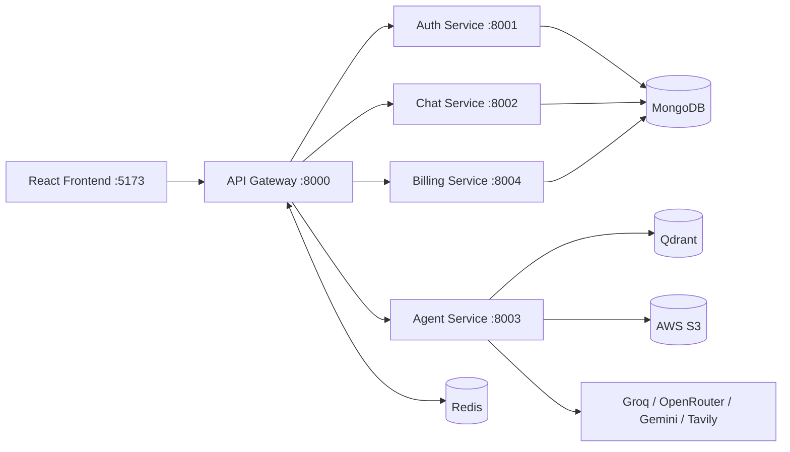
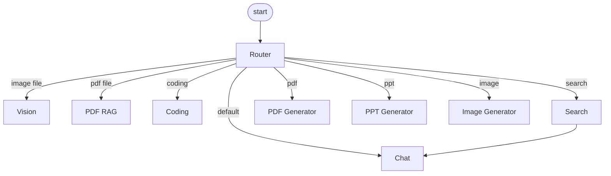

# NOVA-AI — Multi-Agent AI Workspace

A full-stack AI productivity workspace built on a **microservices architecture**. A LangGraph supervisor routes each user request to a specialized agent: chat, web search, code generation, PDF Q&A (RAG), PPT/PDF generation, image generation, and image analysis.

<!-- Add a screenshot or GIF here:  -->

## Features

- **Auto-routing:** a router node picks the right agent from the prompt intent and the uploaded file type
- **Chat with memory:** conversation context kept in Redis (24-hour sliding window)
- **Web search:** live results with citations (Tavily)
- **Coding agent:** code generation, review and debugging, with a live HTML/CSS/JS preview panel and ZIP download
- **PDF RAG:** upload a PDF and ask questions grounded in it (Qdrant vector search)
- **Document generation:** `.pptx` and `.pdf` files generated and stored on AWS S3 with download links
- **Image generation** and **image analysis** (vision)
- **Auth, credits and billing:** Google sign-in, per-plan credits, Razorpay payments
- **Rate limiting:** per-agent, Redis-backed rolling window

## Architecture



| Service | Port | Responsibility |
|---|---|---|
| Frontend | 5173 | React UI, live artifact preview |
| API Gateway | 8000 | Single entry point, session check via Redis, proxies to services |
| Auth | 8001 | Firebase (Google) login, user and session management, credit deduction |
| Chat | 8002 | Conversations and message history |
| Agent | 8003 | LangGraph supervisor and all AI agents |
| Billing | 8004 | Razorpay orders and payment verification |

### Agent routing (LangGraph)



| Agent | Purpose | Tools |
|---|---|---|
| Chat | General conversation with memory | Groq |
| Search | Live web answers with citations | Tavily + Groq |
| Coding | Generate, review, debug code | OpenRouter (DeepSeek) |
| PDF RAG | Q&A over uploaded PDFs | pdf-parse + Qdrant |
| PPT Generator | Create `.pptx` presentations | PptxGenJS + S3 |
| PDF Generator | Create `.pdf` documents | PDFKit + S3 |
| Image Generator | Prompt engineering + image creation | Pollinations + S3 |
| Vision | Analyze uploaded images | Google Gemini |

## Security design

- Firebase handles identity; the Gateway validates a server-side session ID stored in Redis (HTTP-only cookie)
- Internal services are not exposed publicly; the Gateway injects a verified `x-user-id` header
- Razorpay webhook signatures verified with HMAC SHA256
- Rolling 60-second rate limits per user, per agent (e.g. Chat 20/min, Coding 5/min, Image 3/min)
- Credit system: each AI task deducts credits; users are prompted to upgrade at zero credits

## Tech stack

**Frontend:** React, Vite, Tailwind CSS, Redux Toolkit, Axios
**Backend:** Node.js, Express, Mongoose, ioredis, Multer
**AI:** LangChain, LangGraph, Groq, OpenRouter, Google Gemini, Tavily, Qdrant
**Infra:** MongoDB, Redis, AWS S3, Firebase Auth, Razorpay, Docker

## Project structure

```
NOVA-AI/
├── backend/
│   ├── gateway/            # API Gateway (8000)
│   ├── shared/redis/       # Shared Redis client
│   ├── services/
│   │   ├── auth/           # Auth service (8001)
│   │   ├── chat/           # Chat service (8002)
│   │   ├── agent/          # LangGraph agents (8003)
│   │   └── billing/        # Billing service (8004)
│   └── docker-compose.yml
├── frontend/               # React app (5173)
├── scripts/renew-credits.js
├── start-all.bat / start-all.ps1
└── PROJECT_STRUCTURE.md    # Detailed architecture guide
```

See [PROJECT_STRUCTURE.md](PROJECT_STRUCTURE.md) for the full file-by-file breakdown, schemas and rate limits.

## Getting started

### Prerequisites

- Node.js 18+
- MongoDB, Redis and a Qdrant instance (local or cloud)
- API keys / accounts: Firebase, AWS S3, Groq, OpenRouter, Google Gemini, Tavily, Razorpay

### Setup

```bash
git clone https://github.com/himeshnama007/NOVA-AI.git
cd NOVA-AI

# install dependencies (root, backend services, frontend)
npm install
```

Create a `.env` file inside each service folder (`gateway`, `auth`, `chat`, `agent`, `billing`) and in `frontend`, with the keys listed in the prerequisites. Never commit `.env` files or `serviceAccount.json`.

### Run

```bash
# all services + frontend together
npm run dev
```

On Windows you can also run `start-all.bat`, which starts Redis (via WSL) and every service.

Open `http://localhost:5173`.

| Command | What it starts |
|---|---|
| `npm run dev` | All services + frontend |
| `npm run dev:backend` | 4 microservices + gateway |
| `npm run dev:agent` | Agent service only |
| `npm run renew-credits` | Credit renewal script |

## Known limitations

- Runs locally; not yet deployed
- Depends on several third-party APIs, so each key must be configured
- Image generation quality depends on the external provider

## Acknowledgements

The base multi-agent structure was learned from a tutorial: Virtual Code. The backend integration, services setup and extensions were built on top of it.

## Author

**Himesh Nama** — [GitHub](https://github.com/himeshnama007) · [LinkedIn](https://www.linkedin.com/in/himeshnama007/)
